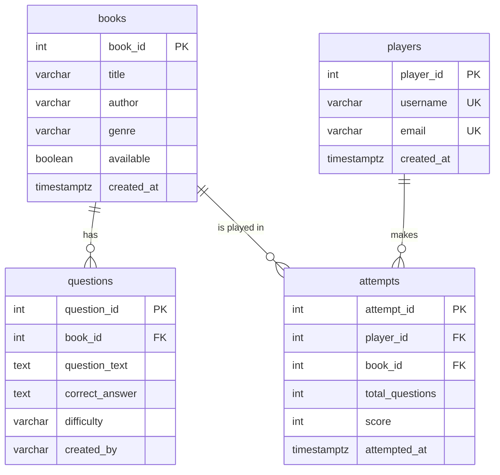

# 🗄️ Book Quiz Database — Session 5 (PostgreSQL)

The PostgreSQL design for the AI Book Quiz idea: books, players, AI-written questions, and players' quiz attempts.

All files were run on **PostgreSQL 16**. The real output is in [`TEST_RESULTS.md`](TEST_RESULTS.md) and `results/`.

---

## 1. Project idea and tables

Players take quizzes about books. AI writes the questions for each book, and each attempt saves the player's score.



| Table | Purpose | Relationship |
|---|---|---|
| `books` | The book catalog (same fields as the Express API) | Parent of `questions` and `attempts` |
| `players` | People who play | Parent of `attempts` |
| `questions` | Quiz questions, written by AI | Many questions → one book |
| `attempts` | One row each time a player plays a book's quiz | Many attempts → one player and one book |

---

## 2. Keys and constraints

| Table | Constraint | Rule |
|---|---|---|
| all | `PRIMARY KEY` (`GENERATED ALWAYS AS IDENTITY`) | The database creates the id; you can't set it yourself |
| `books` | `UNIQUE (title, author)` | The same book can't be added twice |
| `books` | `NOT NULL` + `CHECK (length(trim(x)) > 0)` | Title, author and genre are required and can't be just spaces |
| `books` | `DEFAULT TRUE` on `available` | New books are available unless told otherwise |
| `players` | `UNIQUE username`, `UNIQUE email` | No duplicate accounts |
| `players` | `CHECK` length 3–30, `CHECK` email pattern | Valid usernames and emails only |
| `questions` | `FOREIGN KEY book_id → books ON DELETE CASCADE` | Deleting a book deletes its questions |
| `questions` | `CHECK difficulty IN ('easy','medium','hard')` | Only 3 difficulty levels |
| `attempts` | `FOREIGN KEY player_id → players ON DELETE CASCADE` | Deleting a player deletes their attempts |
| `attempts` | `FOREIGN KEY book_id → books ON DELETE RESTRICT` | A book that has scores can't be deleted (protects history) |
| `attempts` | `CHECK (score >= 0)`, `CHECK (total_questions > 0)`, `CHECK (score <= total_questions)` | Scores always make sense |

`03_constraints_test.sql` breaks each rule on purpose and shows the error for each one.

---

## 3. Files

| File | What it does |
|---|---|
| `01_schema.sql` | Creates the 4 tables (drops old ones first, so you can re-run it) |
| `02_seed.sql` | AI-generated sample data: 12 books, 6 players, 21 questions, 20 attempts |
| `03_constraints_test.sql` | 10 statements that must fail, one per constraint |
| `04_crud.sql` | Create, read, update, delete a book (with `RETURNING`) |
| `05_joins.sql` | `INNER JOIN` of 3 tables, two `LEFT JOIN` examples |
| `06_group_by.sql` | Leaderboard, per-book stats with `HAVING`, questions per difficulty |
| `07_pagination.sql` | `LIMIT/OFFSET` pages 1–3 and keyset pagination |
| `08_transaction.sql` | `COMMIT`, `ROLLBACK` after an error, manual `ROLLBACK` |
| `09_index.sql` | `EXPLAIN ANALYZE` before and after one index |
| `run_all.sh` | Runs every file in order and saves the output in `results/` |
| `TEST_RESULTS.md` | All outputs from a real run |

---

## 4. How to run

**Requirement:** PostgreSQL 14 or newer (tested on 16), with `psql`.

**1. Create the database (once):**

```bash
createdb book_quiz
```

Or, inside `psql`: `CREATE DATABASE book_quiz;`

**2a. Run everything (macOS / Linux / Git Bash on Windows):**

```bash
cd database
bash run_all.sh
```

If your PostgreSQL needs a user and password:

```bash
PGUSER=postgres PGPASSWORD=yourpassword bash run_all.sh
```

**2b. Or run one file at a time** (any system, including Windows PowerShell):

```bash
psql -U postgres -d book_quiz -f 01_schema.sql
psql -U postgres -d book_quiz -f 02_seed.sql
psql -U postgres -d book_quiz -f 05_joins.sql
```

**2c. Or use pgAdmin:** open the **Query Tool** on `book_quiz`, open a file, and press **Execute (F5)**. Run `01` and `02` first.

Always run `01_schema.sql` and `02_seed.sql` first. They reset the database, so the results match `TEST_RESULTS.md`.

---

## 5. Results summary

| Requirement | File | Result |
|---|---|---|
| 2–4 related tables | `01_schema.sql` | 4 tables, 3 foreign keys ✅ |
| PK, FK, constraints | `03_constraints_test.sql` | All 10 bad statements rejected, data unchanged ✅ |
| AI-generated schema + data | `01`, `02` | Created and loaded ✅ |
| CRUD | `04_crud.sql` | Insert → select → update → delete, 0 rows left ✅ |
| JOIN | `05_joins.sql` | 3-table join; `LEFT JOIN` finds "Deep Work" (0 questions) and "mona_k" (never played) ✅ |
| GROUP BY | `06_group_by.sql` | Leaderboard: ahmed_reader first at 80%; `HAVING` keeps 6 books ✅ |
| Pagination | `07_pagination.sql` | Pages of 5 / 5 / 2; keyset page 2 matches OFFSET page 2 ✅ |
| Transaction | `08_transaction.sql` | COMMIT saves book + 2 questions; error → ROLLBACK saves nothing; manual ROLLBACK restores 4 rows ✅ |
| Index + EXPLAIN ANALYZE | `09_index.sql` | Seq Scan → Index Scan, see below ✅ |

---

## 6. Index evaluation

**Query:** a player's 10 most recent attempts (a profile page).

```sql
SELECT attempt_id, book_id, score, attempted_at
FROM attempts
WHERE player_id = ?
ORDER BY attempted_at DESC
LIMIT 10;
```

PostgreSQL does **not** create indexes on foreign keys automatically, so `attempts.player_id` starts without one. To get a realistic table, the test adds 2,000 players and 200,000 attempts, then removes them at the end.

**Index:**

```sql
CREATE INDEX idx_attempts_player_time ON attempts (player_id, attempted_at DESC);
```

| | Before | After |
|---|---|---|
| Plan | `Parallel Seq Scan` + `Sort` | `Index Scan using idx_attempts_player_time` |
| Rows read | All ~200,000 (99,960 removed by filter per worker) | Only the 10 needed |
| Execution time (saved run) | 8.35 ms | 0.026 ms |
| Execution time (5 repeated runs) | 12–17 ms | 0.03–0.16 ms |

**Why it works:** `player_id` comes first, so PostgreSQL jumps straight to one player's rows. `attempted_at DESC` comes second, so those rows are already newest-first. The `Sort` step disappears, and `LIMIT 10` stops after 10 rows.

**Cost:** the index uses about 6 MB next to an 11 MB table, and every insert into `attempts` must also update it. That's worth it here, because reading a player's history is far more frequent than writing a new attempt.

**Note:** exact times change between machines and runs. The plan change (`Seq Scan` → `Index Scan`) is the reliable signal.

---

## 7. AI usage

This assignment was built with **Claude (Anthropic)** as an assistant, then run on a real PostgreSQL 16 database and checked.

| Step | What AI did | How it was checked |
|---|---|---|
| Design | Proposed 4 tables for the book-quiz idea, with keys and delete rules | Reviewed that every relationship matches a real use case |
| Schema | Wrote `01_schema.sql` with all constraints | `03_constraints_test.sql`: each of the 10 rules rejects bad data |
| Sample data | Generated books, players, quiz questions and attempts | Loaded without errors; question answers checked for accuracy |
| Queries | Wrote CRUD, JOIN, GROUP BY, pagination, transaction and index files | Ran all files; outputs saved in `TEST_RESULTS.md` |

**Fixes made after reviewing the results:**
- The first `EXPLAIN ANALYZE` without the index showed 401 ms, while the scan inside it took only ~4 ms. The extra time was a one-time warm-up cost, not the query. I re-measured 5 times (12–17 ms before, under 0.2 ms after) and added an unmeasured warm-up run before each `EXPLAIN ANALYZE` so the comparison is fair.
- The bulk test data is deleted at the end of `09_index.sql`, so later queries still see the original 20 attempts.

> ✍️ Add your own notes here: which prompts you used and what you changed by hand.
